# Energy Weapons Update: hand-off spec for Rampage Road

Audience: the Opus 5.5 agent that will build this. Everything here was designed and approved by the user in conversation; where something is a recommendation rather than a decision, it says so. Images are in `images/` next to this file (open the .md with the folder alongside it so the links resolve).

Overview sheets: 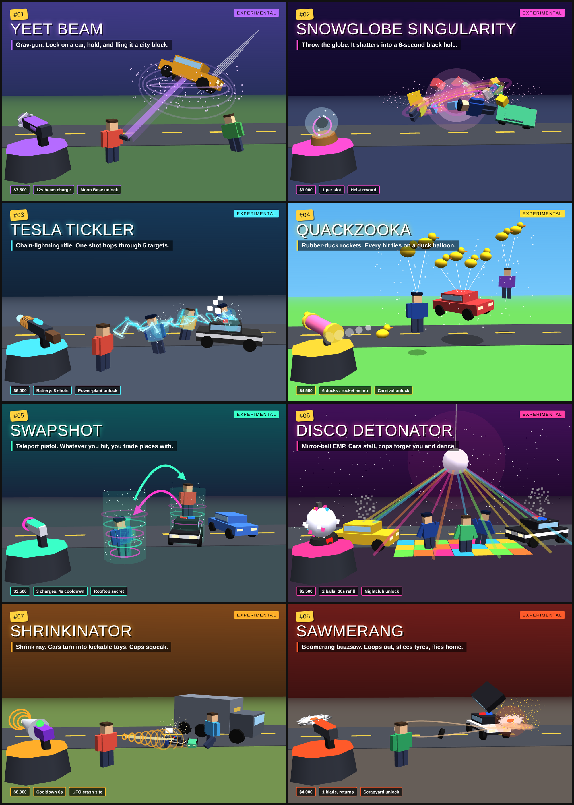 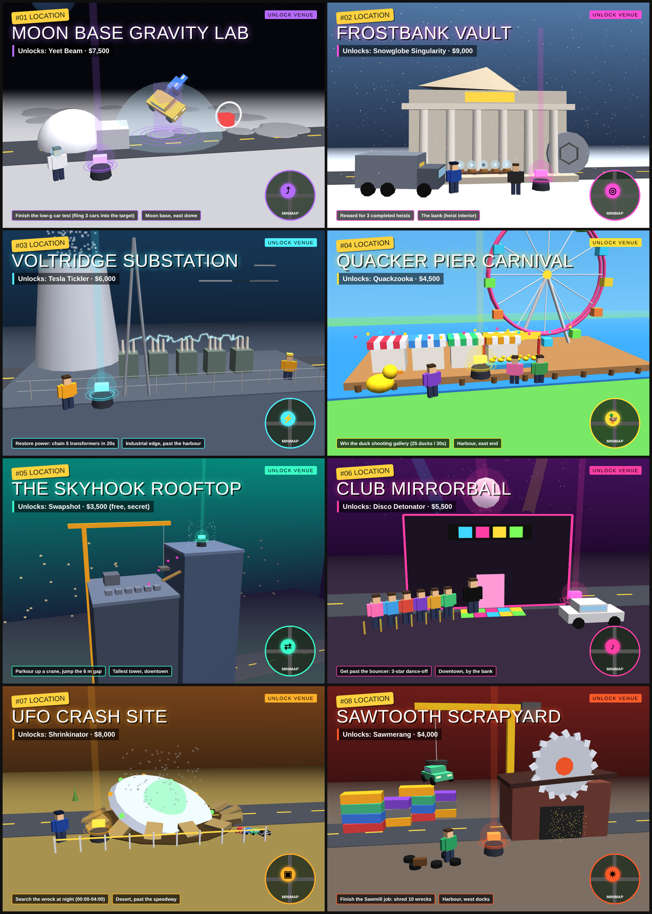

---

## 0. What the user decided (do not re-litigate)

1. **Keep the 8 original weapon designs** (names, mechanics, prices, unlocks below).
2. **No lasting points of interest (POIs) in the world.** Nothing stays on the map, nothing on the minimap, nothing survives a restart. Four earlier POI looks are now short-lived **attack visuals** (Yeet Yard, Anomaly, Afterparty, Slice Alley destruction) that exist only while the effect plays and fade out within seconds. The other four POI ideas were dropped or reduced to a flash.
3. **Sawmerang:** no props or marks along its path. The visual is only the destruction of what the blade actually hits (sliced lamp post, roof sliced off a car, popped tyres, sparks).
4. The user also wants to *see* the **unlock venues** (carnival, nightclub, rooftop and five more). Their renders and specs are in section 5.
5. Online play must work: all effects have to be correct for every player in a room. Section 2 is the networking design.
6. The user is usage-limit sensitive and wants work done fast. Keep agents to 40 minutes, test the important paths, push only when they pass.

---

## 1. Project context you need

- **Game:** "Rampage Road", a single-file three.js r128 browser game. Everything is in `index.html` (about 6,000 lines, one inline IIFE). Repo `mehb4903-jpg/driftless-drive`, branch `main`, GitHub Pages site. The same `index.html` is bundled into an experimental Android Capacitor APK (see `docs/ANDROID.md`).
- **Source of truth:** a Claude artifact built by another Claude session. The GitHub copy is a three-way merge of that artifact plus GitHub-only additions (`git merge-file -p ours base theirs`). **Anything you add to the GitHub copy survives future merges only if it merges cleanly, so keep each addition in its own clearly named block and touch shared lines minimally** (recurring conflict spots: presence line, `netUpdate` remote lines, the `runFrame` list, `window.__drive`). Tell the user whether the artifact session should also receive the feature (it is the multiplayer source of truth; two copies diverging is the main long-term risk).
- **GitHub-only features that must keep working:** PeerJS multiplayer, Servers menu (default room `srv1`), Firebase Google sign-in and cloud save sync, Import/Copy save, weapon bar + mouse-wheel switching + V to aim, GPS route, TV drawn through a transparent hole in the canvas, lock-ons on on-foot players, El Blick bleeding, freeze-missile behaviour, police-car freeze, bazooka one-shotting the armored truck, phone Get out / in button, PWA/Install button, Android ads (DDADS, Android app only, never on the website).
- **Graphics modes:** Ultra / Classic / Ultralight (the graphics overhaul is being merged separately). New meshes must work in all three: use plain `MeshLambertMaterial`/`MeshBasicMaterial`-style materials through the same material helper the game uses so Ultra's PBR patch (`gfxPatch` / `PBR()`) does not break them, keep effects additive/unlit, and check them in Ultralight too.
- **Testing method (use it):** Playwright with `require('playwright')`, `chromium.launch()`, route the three.js CDN to a local copy (`/tmp/claude-0/-home-user/75e75ac5-9336-513b-8bd2-dfae2633196c/scratchpad/pkgs/three/package/build/three.min.js`), abort other CDNs, serve the repo with `python3 -m http.server 8123`. The `window.__drive` debug hook exposes internals (`P`, `GUN`, `OWN`, `MSL`, `HOUSES`, `HOME`, `PCARS`, `ACT`, `setCar`, `carIndex`, `toggleFoot`, `wantedAtLeast`, `fireMissile`, ...). Add what you need to it (the hook line is a conflict hotspot: append your entries at the end). Two-player tests use a local PeerJS server (`window.DD_PEER_OPTIONS={host:'127.0.0.1',port:9000,path:'/',secure:false}`); see the existing `lockons/t_lock.js` test for a working two-player harness. Take screenshots with the real render loop running. Run tests one at a time with generous timeouts.
- **Reference code to read first** (grep these names in `index.html`): `GUNS`, `GUNSLOT`, `OWN`, `GUN`, `setGun`, `cycleGun`, `wbarUpdate`, `fireMissile`/`fireBlick`/`updateMissiles`/`MSL`, `explode`, `mslHitPlayer`, `freezeNpc`, `oilNpc`, `dmgNpc`, `hurtActor`, `dmgPoliceCar`, `copTargets`, `lockCands`, `atkHit`/`ATK_HP`, `NET` (presence, `NET.now()`, `NET.frz`, `NET.oil`, `NET.dm`, `NET.bx`), `netNq`, `netUpdate`, the shop `buy:` handlers (category list near "Ammo" and "Body armour"), `saveKit`, the accounts module and Import module `STATE`/`SETS`/`NUM` lists, `SYSTEMS.md` (how the systems work).

---

## 2. Online design (read this before any weapon)

### 2.1 How multiplayer works in this game (facts to build on)
- **Topology:** PeerJS WebRTC mesh. Each tab has its own peer id; the first tab in a room claims `driftless-<room>-host` and acts as the introducer only. Up to 8 players. There is **no authoritative game server**.
- **Presence:** every client broadcasts its own state about 18 times a second as one small keyed object (position, heading, gun index `g`, health, `bl`/`bd` bleed, `ice`, `ak` armored truck, `ac`/`pc` actors and police cars, `os` orbital strikes, `om` mined ore, ...). The presence key limit was raised to 64 keys. Every addition costs bandwidth for 7 peers, so keep new fields small and time-limited.
- **Shared clock:** `NET.now()` returns synchronized room time. Anything that is a **pure function of the clock** (traffic, signal lights, the armored truck schedule) is identical on every client with zero messages. This is the cheapest and most robust sync tool, and you should prefer it.
- **Victim-authoritative hits:** damage and statuses on *another player* are applied by the **victim's own client**. The shooter writes a small addressed record into its presence (for example `NET.frz = {targetId, seq, at}`, `NET.oil = {...}`, or accumulated `NET.dm`), the victim's client sees a record with a new `seq` addressed to its id, and applies the effect to itself. Mirror this pattern.
- **Local simulation of the world:** each client simulates its own pedestrians and police; traffic cars are shared by clock, and hits on traffic cars are passed to other clients as flags in the compact traffic-hit list (`netNq`, flag bits: 1 wrecked, 2 frozen). Explosions are broadcast as a short ring of recent events with a sequence number (`NET.bx`) so each client plays `boomFx` once.

### 2.2 Rules for the new weapons
1. **Cosmetics are replayed locally from one tiny event.** The shooter's client emits an event `fx` carrying `type, seq, t0 (NET.now()), origin, aim/seed, params`. Every client draws the effect itself from `t0`, using deterministic maths (a function of `NET.now() - t0` and the seed). No per-frame effect data goes over the wire. Late joiners ignore events whose `t0` is older than the effect's duration.
2. **Effects on a player or their car are applied by that player's client** (victim-side), through one generic addressed status record `st = {to, seq, kind, t0, a, b}`. Kinds: `float`, `stun`, `dance`, `stall`, `shrink`, `swap`, `yeet`, `pull`. The victim validates before applying (see 2.4). Statuses are always time-capped so nobody can be stuck.
3. **Effects on NPC traffic cars** use the existing mechanism: apply locally on the shooter's client and set new flag bits in the `netNq` hit record so other clients apply the same status to the same shared car. Add bit values after the existing 1 and 2; keep the record a small integer.
4. **Pedestrians, police cars and cops are local to each client.** The shooter's client applies the effect to its own copies, and every client plays the cosmetic from the broadcast event so everybody sees the same thing even though the actors are not shared. Gameplay consequences for police (wanted stars) belong to the shooter's client only (wanted level is per player).
5. **The armored truck** is a shared, clock-driven entity (`ATK`, hit through `atkHit(damage, kind)`, state flags in presence key `ak`). Every new weapon routes truck interaction through `atkHit` with a new `kind` string (never edit its HP directly) so the existing sync keeps working. Weapon rules for the truck (below) must not become a cheaper way to kill it than the bazooka (600 HP, one-shot).
6. **Wanted stars** are the shooter's own: use the existing `wantedAtLeast(n)` / seen-by-police logic.
7. **Per-weapon limits** (cooldowns, max active effects) are enforced on the shooter's side *and* checked by the victim's side.

### 2.3 Wire format (proposal)
Two new presence keys, both short arrays, both pruned after 6 s:
- `fx`: recent cosmetic events, newest last, max 4 kept: `[[type, seq, t0, x, y, z, a, b, seed], ...]` where `type` is a small int (1 yeet, 2 hole, 3 zap, 4 duck, 5 swap, 6 disco, 7 shrink, 8 saw). Receivers keep a per-sender `lastSeq` and play only new seqs.
- `st`: addressed statuses, max 2 kept: `[[toIdHash, seq, kind, t0, a, b], ...]`. Receivers act only on records addressed to them with a new seq.

Reuse the existing sequence/de-duplication idiom of `NET.bx` and `NET.frz`. Check how presence values are validated on receive (there are shape/finite checks such as `vec`/`num`/`arr` helpers) and add the same defensive parsing for `fx` and `st`: reject non-finite numbers, clamp ranges, cap array length.

### 2.4 Validation and anti-cheat (cheap but real)
- The victim accepts a status only if the shooter is within the weapon's range of the victim's last-known position, the shooter currently has that weapon selected (`g` in presence equals the weapon index), the seq is new, and the shooter's per-weapon cooldown has elapsed (track `lastAt` per sender).
- Statuses have hard caps: duration, height, force. For example `float` height at most 25 m, `pull` force clamped, `swap` target position must pass the free-spot check, `yeet` speed clamped.
- Never apply a status to a victim who is in a protected context: in the bank, mall, bunker, space/moon rules as the game already treats safe zones, a sitting TV viewer, mid-heist cutscene, the orbital console, or on the phone `ORB`/`H` overlays. Use the existing guards that damage already uses; if there is a central "can be hurt" check, use it.
- A player cannot target teammates in a heist crew in ways that break the heist (see Tesla and Swapshot notes).

### 2.5 Desync handling
- Deterministic effects are driven by `NET.now() - t0`; a client with a bad clock adopts the room clock automatically, so visuals line up.
- If the shooter disconnects mid-effect, remaining clients finish the effect from the data they have; statuses simply expire.
- Frozen-in-flight objects (Yeet, Sawmerang) must resolve to a safe final state if either side stops updating: landing positions are computed from the launch data, not from the thrower afterwards.
- Add a debug counter in the `__drive` hook for sent/applied/rejected events so tests can assert on it.

---

## 3. Shared engineering work (do this first)

1. **Shop category "Experimental"** and the `GUNS` entries: each new weapon is a `GUNS` entry (`name, dmg, rate, mag, rl, price, cat, blurb`) plus one flag (`exp: 'yeet'` etc.). Buying uses the existing `buy:` pattern (`pay(price, name)`, `OWN.add(i)`, `saveKit()`), with `blurb` lines taken from section 4. Unlock-gated weapons (everything except the Quackzooka-style open ones) appear in the shop only after the unlock has been earned (see section 5); until then they show as locked with the hint.
2. **Weapon bar and keys:** the bar (`wbarUpdate`) lists owned weapons in `GUNSLOT` order and keys 1 to 0 are all used. With up to 18 weapons you need a second row or page and a next/previous cycle that already exists on the mouse wheel and the phone `Gun` button. Extend `GUNSLOT` minimally and make the bar wrap or scroll; verify on desktop and a phone viewport.
3. **Saving and sync:** new owned weapons go in the existing `dd-guns` set (already synced). Unlock progress needs a new key, for example `dd-xunlock` (an object of venue ids to 1, newest-rev-wins STATE style). Add it to the `STATE` list in **both** the accounts module and the Import module (both near the end of `index.html`). Ammo/charges are per session and need no save. Graphics key `dd-gfx` is a device setting and is not synced.
4. **Generic status engine** (client side, one small module): `applyStatus(kind, t0, a, b)` for our own player/car with timers, plus the same for NPC cars/peds/police copies; always visible on the HUD as a small icon with timer. Cap every timer.
5. **Generic effect renderer:** a pool of reusable meshes/InstancedMeshes per effect type with a global cap, additive materials, no colliders, a 120 m draw distance cut, disposal on fade. Works in all three graphics modes.
6. **Networking hooks:** `netFx(type, ...)` to enqueue into `fx`, `netSt(toId, kind, ...)` to enqueue into `st`, receivers in `netUpdate`. Keep the presence line additions as separate single lines to keep merges clean.
7. **`window.__drive` additions** for tests: the weapon indices, `fireWeapon(i)`, an `fx` log, and spawn helpers.
8. **Lock-ons and the weapon-bar/wheel code must treat the new weapons as normal guns** (they are not locking weapons; only El Blick and the heli missiles lock).

---

## 4. The eight weapons

Prices and unlocks are the approved ones. "Online" for each weapon is the concrete application of section 2.

### 4.1 Yeet Beam (grav-gun, $7,500)
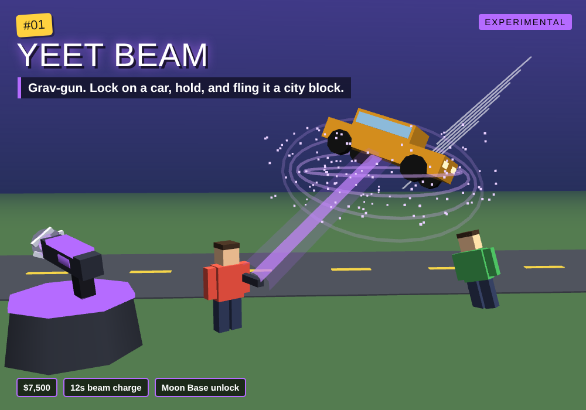
Attack visual (approved look, temporary): 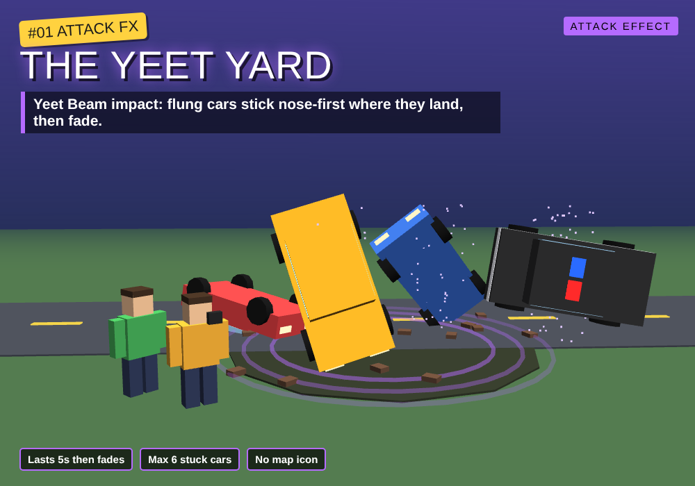

- **Fire:** hold LMB to grab a car or person within 40 m; the beam lasts up to 3 s and the target hovers about 4 m up in front of you. Release to fling at 45 m/s along your aim. Battery of 3 grabs, one recharges every 12 s. No ammo purchase.
- **People on foot:** grab lasts 1.5 s only. Fling does 25 damage plus a 1 s stagger; landing damage capped at 40.
- **Cars:** the main use. A flung car is a projectile: car-vs-car impact deals 35% HP to both, a pedestrian hit deals 60. The flung car's driver gets the `yeet` status: their client plays the arc and they keep control after landing. Cannot grab a car you or a crew member is driving.
- **NPCs and police:** flung like players. Throwing a police car adds +1 wanted star.
- **Armored truck:** too heavy to lift; the beam only drags it 3 m sideways and halts it for 2 s via `atkHit(0, 'yeet')` (no damage). Useful to set up an ambush.
- **Attack visual:** a flung car that lands hard ends up stuck nose-first in the ground with a purple shockwave ring and dirt chunks for 5 s, then sinks and fades over 1.5 s (the car returns to normal damaged state for its owner, or despawns if it was NPC traffic). At most 6 stuck cars per client; the ring and 12 chunks are pooled.
- **Online:**
  - Grab: shooter emits `fx` type 1 `{origin, targetKind, targetId}` and a `st` `pull` to the victim; the victim's client holds its own avatar/car at the beam point and zeroes drive input for the hold time (the UFO beam already does this via `NET.wasPulled`-style input zeroing; reuse that path).
  - Fling: the shooter sends `{p0, v0, t0}`; the arc is `p(t) = p0 + v0 t + g t²/2` evaluated by everyone from `NET.now() - t0`. The **victim's client moves its own car/avatar along the arc** (so it is the owner of the object), checks its own landing and collisions, and reports damage using the normal damage path. Other clients just render it.
  - For an NPC traffic car, the shooter's client runs the arc and writes the new `netNq` flag so others show it flying and then wrecked or stuck.
  - Safety: the victim's input is locked until landing (at most 2.5 s), then returns. If the victim's client does not confirm landing within 3 s, others snap the car to the computed landing point.
  - Validate: range 40 m, speed clamp, flung object's mass class (truck refuses).
- **Risks:** desync if the owner moves the car mid-flight (lock input), stuck-in-geometry landings (use the normal car-on-ground resolver, drop a stuck car to a free spot), abuse against players in safe zones.
- **Unlock:** Moon Base Gravity Lab challenge (section 5).

### 4.2 Snowglobe Singularity (black-hole grenade, $9,000)
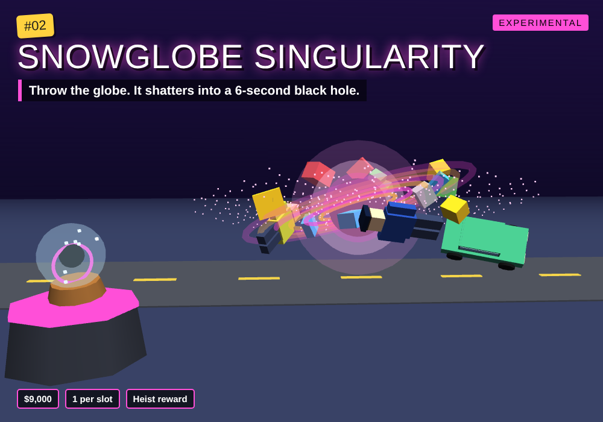
Attack visual (approved look): 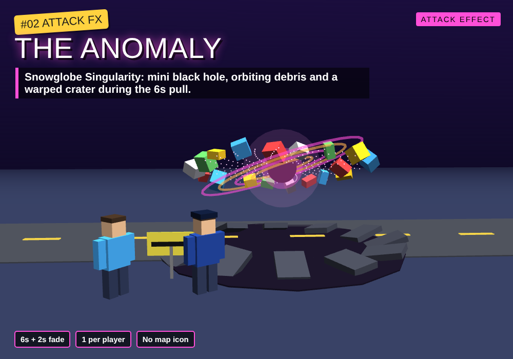

- **Fire:** thrown grenade, 1.2 s fuse after landing. You carry 1; a refill costs $900; 20 s cooldown between throws.
- **Effect:** 6 s black hole, 14 m pull radius. People on foot are pulled (strong near the core, escapable at the edge), take 15 damage per second within 2 m, and are flung outward at the end for 20 damage. Cars orbit slowly, take 30 HP/s at the event horizon, and are launched outward at the pop.
- **NPCs and police:** NPCs ragdoll and orbit; police cars stall inside the radius (good for escaping a chase).
- **Armored truck:** pinned in place (cannot leave the radius) and takes 30 HP/s, 180 over the full 6 s via `atkHit(dt*30, 'hole')`; strong setup, not a kill.
- **Attack visual:** mini black hole with accretion rings and orbiting debris boxes over a warped cracked crater, lasting exactly the pull (crater grows in over 0.3 s; the pop scatters debris; the crater slabs flatten and fade over 2 s). One active per player; debris is one InstancedMesh (18 boxes), crater 12 merged slabs, around 250 particles, none beyond 120 m.
- **Online:** one event `fx` type 2 `{pos, t0, seed}`. The pull is **victim-side**: every client applies the radial pull to its own avatar and own car from the same deterministic formula of `NET.now() - t0` and the position, so no per-frame messages. Damage ticks are applied by the victim's client to itself. The shooter's client applies the pull/damage to its local NPCs and police and writes the `netNq` stall/launch flags for shared traffic cars. One hole per player; a second throw while one is active is refused.
- **Risks:** stacking several holes from several players (global cap of 3 active holes per room; a client ignores extras), pulling players through walls (clamp the pull so it does not push through solid geometry; use the existing collision resolver), mod-abuse (range-check the grenade origin against the thrower).
- **Unlock:** automatic reward after completing 3 heists (Frostbank Vault venue).

### 4.3 Tesla Tickler (chain-lightning rifle, $6,000)
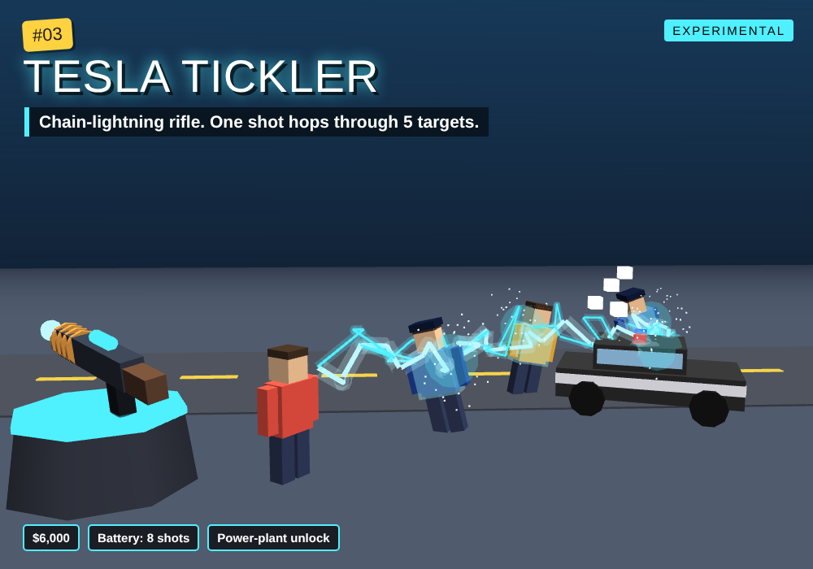
Optional effect look: 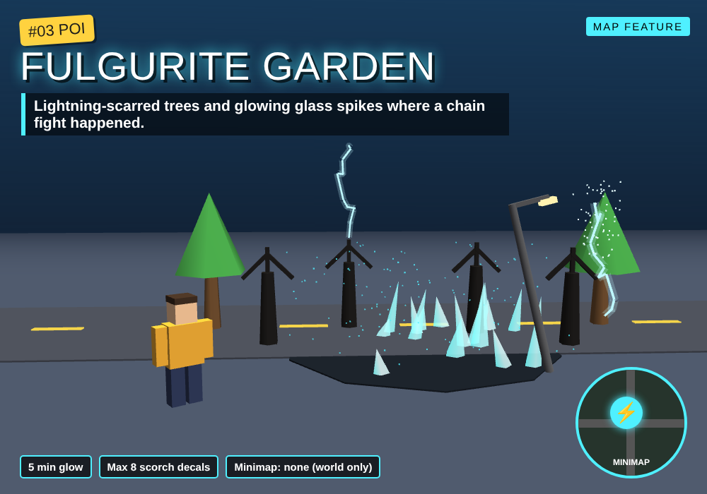 (the old "map feature" label on this image is out of date; the design now is a 2 s spike-and-scorch effect at each hop point, shrinking away).

- **Fire:** semi-auto (rate 0.9), 8 shots per coil pack, reload 2.6 s, packs of 8 cost $300.
- **Chain:** first hit 30 damage; each hop jumps to the nearest unhit target within 9 m and deals 70% of the previous hop (30, 21, 15, 10, 7). Every target is "tickled": 0.6 s stun plus a jitter animation. Cars: the arc goes into the driver and deals 15% of the car's HP; engine sputters, top speed down 50% for 2 s. In puddles or rain the hop range doubles.
- **Armored truck:** 60 flat per hit (`atkHit(60, 'zap')`) and it cannot chain off the truck.
- **NPCs and police:** chain happily through crowds and cops; the host/shooter applies damage to its local copies.
- **Online:** hitscan like the Rifle. The **shooter computes the hop chain** (nearest-neighbour with the 9 m cap) over players it currently knows about (remote players from `NET.rem`), NPCs and police, then sends one `fx` type 3 with the polyline of points and one `st` `stun` per player hit (with the damage amount in the normal damage path). The **victim validates** that the shooter was within range and that the hop distance to it is at most 9 m before stunning itself. Bolts are jagged cylinders over 0.25 s, drawn from the polyline by every client. Teammates in a heist crew are excluded from the chain.
- **Cheat guard:** receivers reject chains of more than 5 points or hop distances above 9.5 m.
- **Unlock:** Voltridge Substation challenge.

### 4.4 Quackzooka (rubber-duck launcher, $4,500)
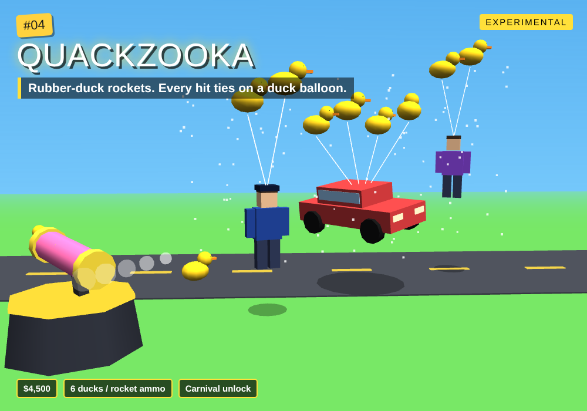

- **Fire:** single-shot launcher, arcing slow projectile (35 m/s, like the bazooka but slower), `mag 1`, reload 1.8 s. Own "duck" ammo, 6 for $500.
- **Effect:** no direct damage. Hit people float up 6 m over 4 s and drift; they can shoot but not move; any shot at their balloons drops them (fall damage). Each extra duck adds height; the third takes them up. Cars lift 4 m with wheels spinning for 5 s, then drop for 20% HP. NPCs float away screaming; a floating cop's spread triples.
- **Armored truck:** needs 4 ducks to lift (each +25% lift). Once lifted it hangs 5 s and drops for 100 damage (`atkHit(100, 'duck')` on the drop). Comic but legitimate.
- **Visual (this is the effect; the giant-duck pond POI was dropped):** duck balloons on lines tied to the victim.
- **Online:** reuse the bazooka's projectile path (`MSL.list` entry with a `rocket:'duck'`-style flag and no explosion). On a hit against a player, `mslHitPlayer`-style: `st` `float{t0, h}` addressed to the victim, whose client applies the float to itself. Balloons are drawn by every client from the `fx` type 4 event (target id, t0, duck count) so everyone sees the same rising victim. For NPC traffic cars: new `netNq` flag bit; for police/peds: local plus cosmetic broadcast. Height cap 25 m, on the moon and in low gravity use the same cap.
- **Risks:** floating players near the moon base or building tops (cap height, force a safe drop), stuck floating if the status is lost (always time-capped, 12 s maximum even when extra ducks stack).
- **Unlock:** Quacker Pier Carnival duck gallery.

### 4.5 Swapshot (teleport pistol, $3,500 secret)
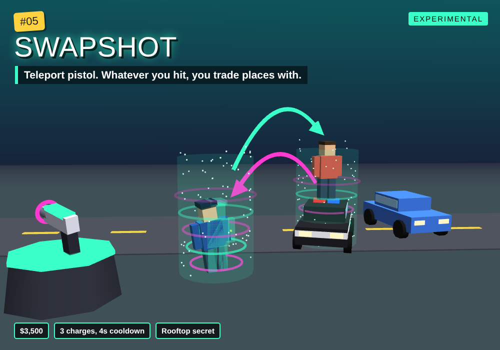
Attack visual: a 1 s teal/magenta portal-ring flash at both ends of a swap (the standing rift and its fast-travel were dropped).

- **Fire:** hitscan, 120 m range, 3 charges, 4 s recharge per charge.
- **People:** instant position swap with a portal flash; 0 damage but a 1 s screen wobble for both. Cars: hit a car and you land on its roof while the car goes where you stood; a headshot on the driver window swaps you into the driver seat and the driver to your spot (a carjack from 120 m). In PvP the driver-seat swap only works on NPC-driven cars, or gives the victim a 3 s stun instead.
- **NPCs and police:** swap a cop into traffic or swap past a roadblock; police lose track of you for 2 s.
- **Armored truck:** swap onto its roof or into its cab to hijack it while moving (skips the shootout). Balance: the guards turn hostile and the alarm adds +2 stars.
- **Online:** the shooter sends `fx` type 5 `{posA, posB, targetId}`; **each side teleports its own entity** (the victim's client moves itself on a `st` `swap{x,y,z}`, validated by the free-spot check and the range check). Never teleport another client's entity from here. Refuse swaps into building interiors or into safe zones, and snap to the nearest free spot using the same ground/solid helpers the teleport/fast-travel code uses. For the truck: `atkHit(0,'swap')` plus the existing hijack flags for the truck phase (design the hijack against the `ATK` state machine in `index.html`; this is the hardest interaction, build it last or ship without the truck hijack at first).
- **Risks:** swapping into geometry, abusing swaps to escape heist containment (disable in heist stages), carjacking a human driver (blocked in PvP as above).
- **Unlock:** Skyhook Rooftop secret.

### 4.6 Disco Detonator (mirror-ball EMP, $5,500)
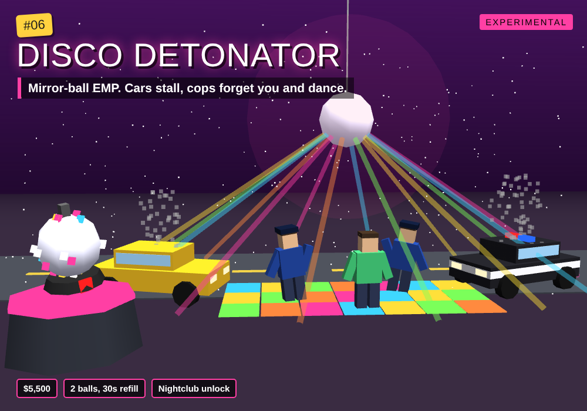
Attack visual (approved look): 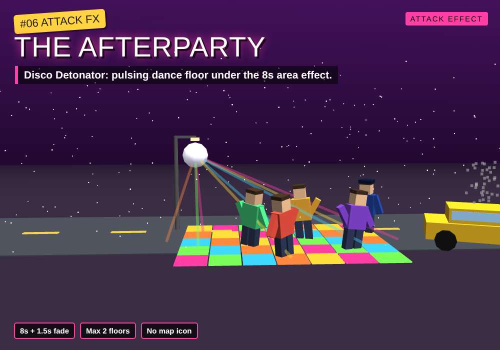

- **Fire:** lobbed item, 2 balls, 30 s to refill each. The ball rises 6 m and the effect lasts 8 s within an 18 m radius.
- **People on foot:** forced to dance for 3 s (cannot fire or run but can look); then immune to dancing for 15 s.
- **Cars:** engine stall for 6 s with flickering lights; helicopters in the radius gently auto-rotate down (no crash); UFO immune.
- **NPCs and police:** dance the full 8 s; police inside lose your trail; leaving the radius while they dance drops your wanted level by 1 star (60 s per-player cooldown so it cannot be chained).
- **Armored truck:** stalls for 8 s, guards dance; doors stay locked (`atkHit(0,'disco')`, flags only).
- **Attack visual:** a pulsing coloured dance-floor disc under the area (tiles pulse at 2 Hz) with the mirror ball and light beams for 8 s, then tiles flicker out over 1.5 s. At most 2 floors per client, one InstancedMesh of about 35 tiles with per-instance colour, about 10 additive cylinder beams, drawn as a decal 5 cm above the road.
- **Online:** one event `fx` type 6 `{pos, t0, seed}`. **Deterministic area effect:** every client checks "am I inside the radius between t0 and t0+8 s" against its own avatar and car and applies `dance`/`stall` to itself with the same timing (victim-side, no per-hit messages). Shared traffic cars stall through a `netNq` flag from the thrower; local NPCs and police dance on every client from the same event. The wanted-star drop is applied only on the thrower's client to the thrower. Cap 2 active floors per room.
- **Risks:** nearly none; guarantee nobody can be stuck dancing (always time-capped), and do not let allies be griefed during a heist (crew members are immune while a heist is active).
- **Unlock:** Club Mirrorball dance-off.

### 4.7 Shrinkinator (shrink ray, $8,000)
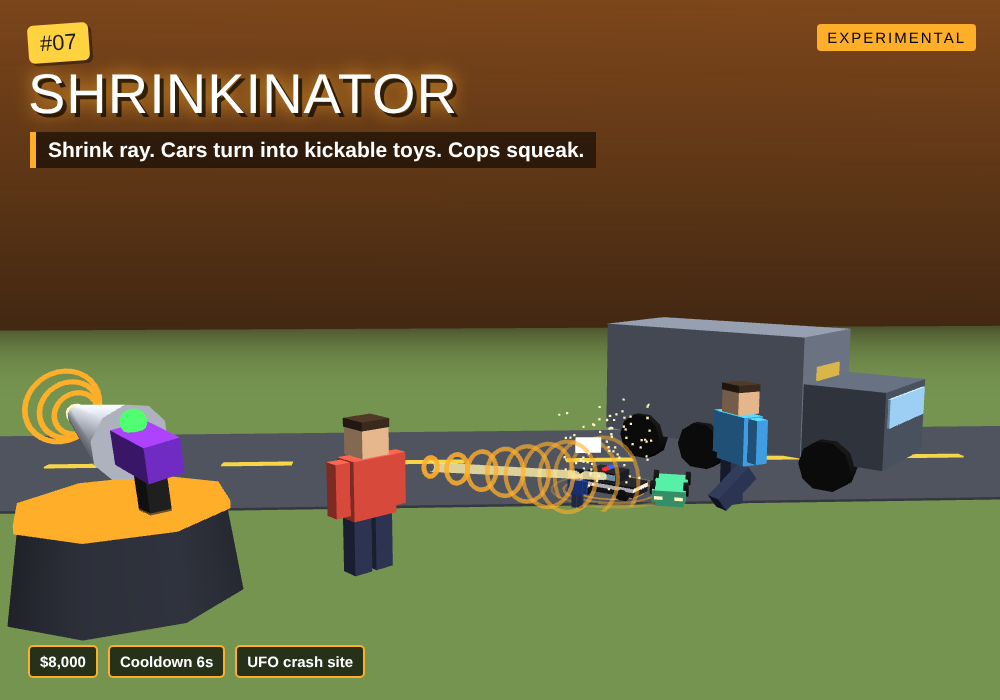
No lasting effect: things grow back when the status ends (the toy-town POI was dropped).

- **Fire:** charged beam (hold 0.8 s), 6 s cooldown, no ammo.
- **People:** shrunk to 30% for 10 s: move speed -40%, damage dealt -70%, high-pitched voice and footsteps, can be stomped (walking over deals 15).
- **Cars:** shrunk to 30% for 12 s; the driver can drive the tiny car at 60% speed; on-foot players can kick it (big impulse, 10% HP); a shrunk empty car can be carried.
- **NPCs and police:** tiny cops fire tiny bullets (2 damage); a shrunk police car cannot ram.
- **Armored truck:** shrinks to 50% for 8 s; guards cannot get out (doors too small); HP unchanged but melee and kick damage doubled (`atkHit(0,'shrink')` plus a scale flag in the truck's state). Slow fun kill route.
- **Online:** victim-side status `st` `shrink{s, t}`: the victim's client scales its own mesh (`group.scale`), its collision radius and movement constants; other clients read the scale from presence (one small field, `sc`, only while shrunk) and scale the remote mesh and hitbox the same way. NPC traffic cars use a `netNq` flag; local peds/cops are scaled locally with the cosmetic event.
- **Risks:** camera clipping for a shrunk player (scale the camera offset by the same factor), mismatched hitboxes across clients (scale the remote hitbox from the broadcast scale, not from a local guess), kick impulses on a car owned by another client (send the kick as a `st` addressed to the owner).
- **Unlock:** UFO Crash Site night search.

### 4.8 Sawmerang (boomerang buzzsaw, $4,000)
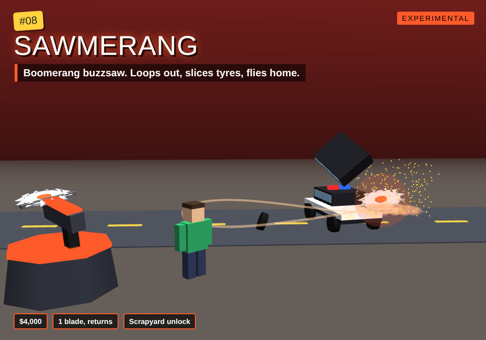
Destruction look (approved; only the destruction, no props along the path): 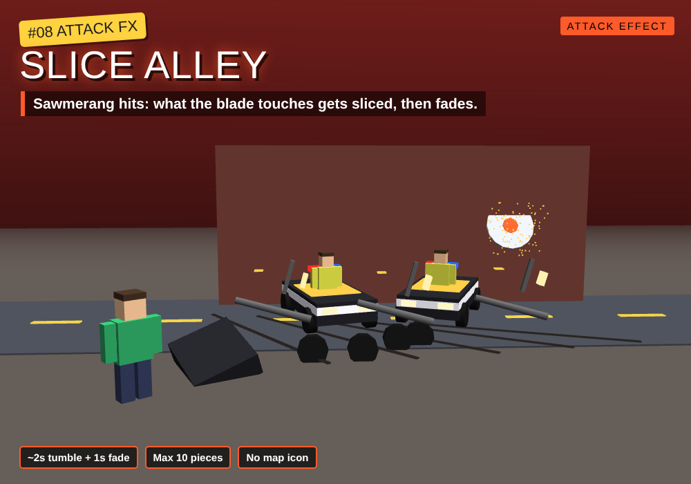

- **Fire:** 1 blade. It flies a fixed elliptical loop (out 25 m, curving back) over 2.2 s and returns to your hand; no second throw until it returns. If it hits a wall it sticks for 3 s then returns. Walking into it early catches it.
- **People:** 35 damage per pass (up to 70 total out and back); hats knocked off.
- **Cars:** pops every tyre it touches (top speed -40%, wobbly steering until repaired); 25% chance per pass to slice the roof off (the car becomes a convertible and the cabin mesh tumbles away; the driver is exposed to bullets); 20% HP per pass.
- **NPCs and police:** cuts through crowds, shreds police tyres to stop a pursuit; popping police tyres adds no star.
- **Armored truck:** 40 per pass and pops tyres (slows it to a crawl) via `atkHit(40,'saw')`; 15 passes to kill, not efficient.
- **Attack visual (final):** only what the blade hits shows damage, in a short burst: a lamp post sliced through, a car roof sliced off, tyres popping, a spray of sparks. Sparks last 0.4 s per hit; the sliced piece tumbles away for about 2 s then fades over 1 s; the cut prop shows intact again. A hit car keeps its real damage (popped tyres, roofless) as ordinary car damage. At most 10 live sliced pieces per client, pooled; each hit uses a pooled copy of the cut part plus 40 spark particles. No grooves, trails or props along the path.
- **Online:** the path is a pure function of `{origin, yaw, t0}` (deterministic), so every client animates the same blade from one `fx` type 8 event. **Hits are resolved by the thrower** for players and NPCs (damage via the normal paths and `st`), and **by the car's owner** for tyre pops and roof slice (a `st` `saw{part}` addressed to the owner), so the damage state lives where the car is simulated. Lamp posts are cosmetic sliced pieces spawned locally on every client from the event (no gameplay state). If the thrower dies or disconnects the blade drops and vanishes.
- **Risks:** the same target hit twice per pass (track per-target hit sets), tyre-pop state when the owner is not the client that sees the hit (always address it to the owner), performance of many sliced pieces (the cap above).
- **Unlock:** Sawtooth Scrapyard sawmill job.

---

## 5. Unlock venues

All eight renders are in `images/*-loc.png`. They are **suggested designs and relative positions**; the only absolute coordinate known is the bank interior, so place venues relative to the city, harbour, speedway and moon base using the existing landmark helpers (`HDEF`/landmark tables, the map `POI` list). A venue is a static mesh group (instanced where repeated) created at startup, gated by graphics mode (a cheaper version in Ultralight), shown on the minimap and the big map **only as a normal landmark** (this is about the venues, not the removed attack POIs), and listed in the fast-travel list the way existing landmarks are. The weapon sits on a glowing pedestal with a light pillar visible from about 150 m; walking into it starts the unlock challenge, or opens the shop entry if already unlocked. Unlock progress is saved in `dd-xunlock` (section 3).

| # | Venue | Image | Unlocks | Place | Challenge |
|---|-------|-------|---------|-------|-----------|
| 4 | **Quacker Pier Carnival** | 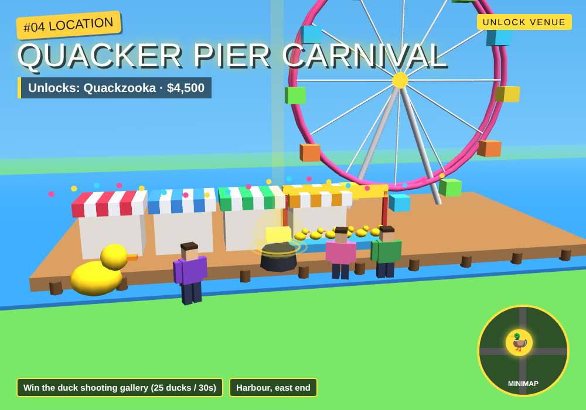 | Quackzooka | East end of the harbour on a pier over the water, 70x25 m. Ferris wheel (rotates as one group), striped booths (instanced), duck shooting gallery, giant duck statue, string lights | Win the shooting gallery: 25 ducks in 30 s with the pistol |
| 6 | **Club Mirrorball** | 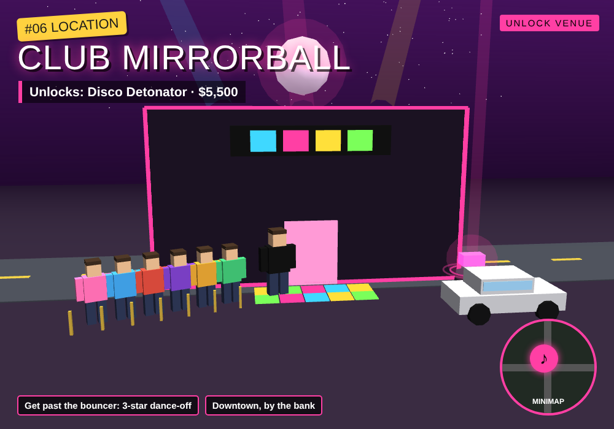 | Disco Detonator | Downtown, one block from the bank, corner lot. Neon facade with mirror-ball sign, queue rope, bouncer, dance-floor glow, searchlights; interior optional, v1 can be facade only | Get past the bouncer: arrive with 3 stars of heat and win a short arrow-key dance-off |
| 5 | **The Skyhook Rooftop** | 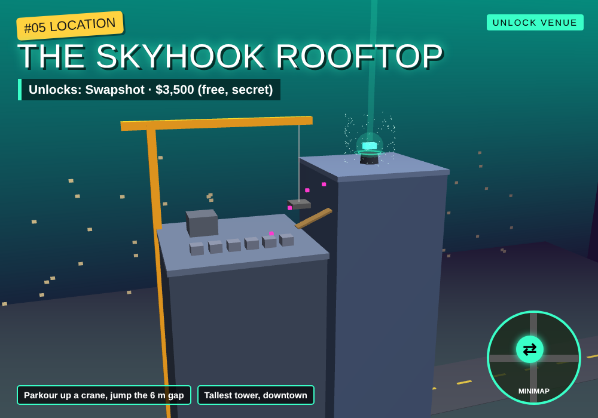 | Swapshot (secret, free the first time) | Tallest downtown tower beside a construction crane; roof 9x9 m, route up the crane, along the jib, across a 6 m gap on a plank; pink cubes mark the route; helicopters cannot land (antennas) | Reach the roof on foot; the first player there takes the gun free, afterwards it is a shop item |
| 1 | **Moon Base Gravity Lab** | 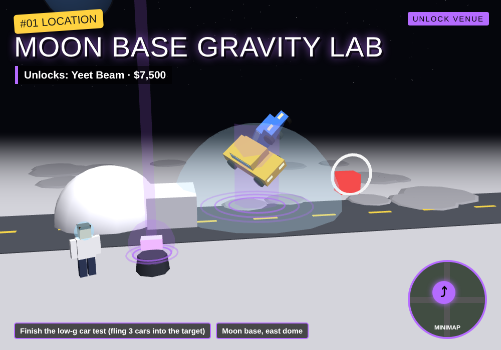 | Yeet Beam | Extra dome on the moon base about 60 m east of the main dome, 50x40 m: glass test dome, floating cars in a beam column, red target cube, craters | Fling 3 cars into the target cube within 90 s with a lab beam |
| 2 | **Frostbank Vault** | 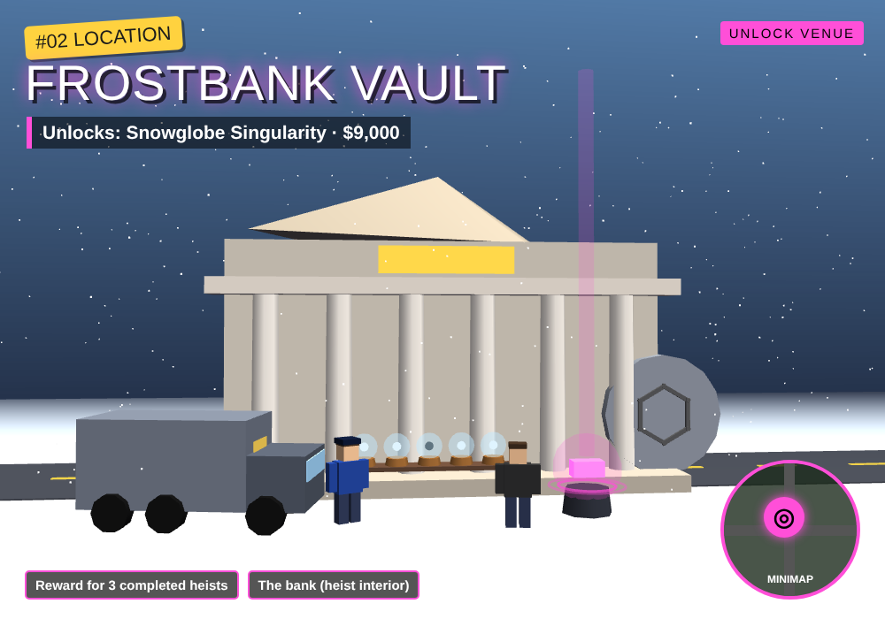 | Snowglobe Singularity | Inside the existing bank heist (vault room) plus its frontage; snow only in the plaza. Round vault door, shelf of snowglobes (one black), armored-truck bay, guard | Automatic after completing 3 heists |
| 3 | **Voltridge Substation** | 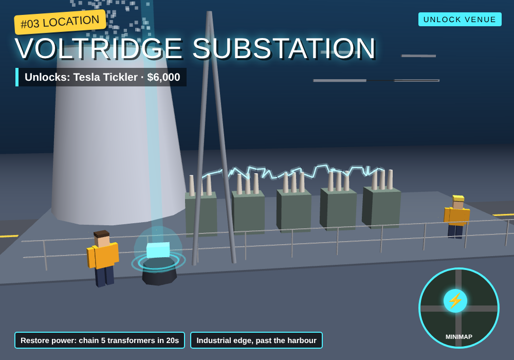 | Tesla Tickler | Industrial edge past the harbour, about 300 m along the coast road, 60x40 m: cooling tower with steam, 5 transformers, pylons, fenced yard | Tag all 5 transformers with arcs in 20 s (a free lab version of the gun during the challenge) |
| 7 | **UFO Crash Site** | 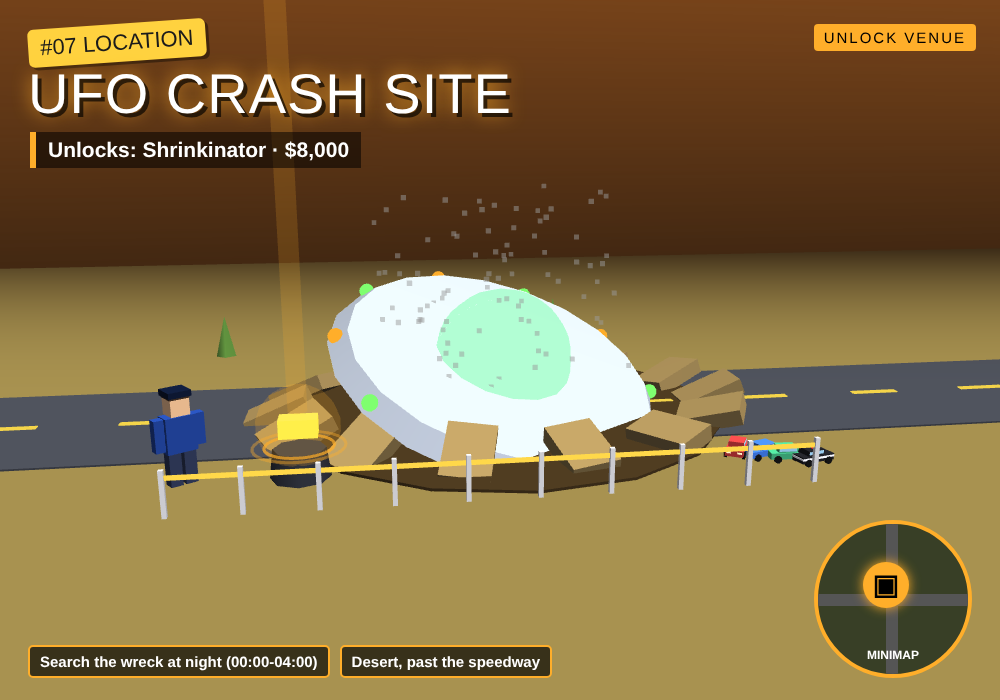 | Shrinkinator | Desert past the speedway, 40 m crater: tilted saucer (reuse the UFO group), caution tape, guarding cop, toy-sized cars | Search the wreck between 00:00 and 04:00 game time while the cop is distracted or wanted is 0 |
| 8 | **Sawtooth Scrapyard** | 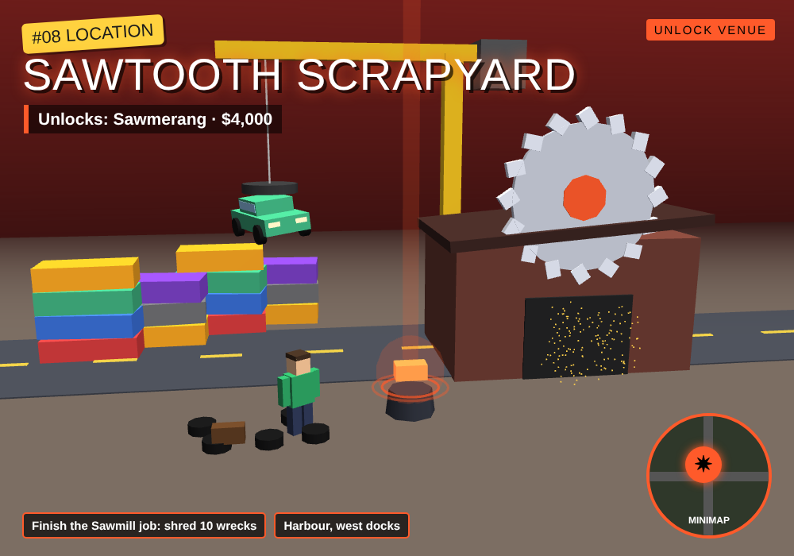 | Sawmerang | West docks of the harbour, 60x40 m: crushed-car stacks (InstancedMesh), magnet crane, sawmill shed with a giant saw sign, guard dog | Finish the sawmill job: shred 10 wrecks (push them into the saw) within 3 min |

Build order for venues: Quacker Pier, Club Mirrorball, Voltridge Substation (the first three weapons), then the Rooftop (cheapest), then the rest.

**Online for venues:** venues are static and identical for everyone. Challenges are personal (each player earns their own unlock), run locally with the existing mini-challenge UI patterns (the mining and heist overlays are good references), and finish by writing `dd-xunlock` and unlocking the shop entry. Shared challenge objects (the duck gallery, the transformers, the shreddable wrecks) are drawn the same for everyone but their state is per player (do not sync it) so other players cannot ruin your attempt. The Rooftop "first player takes it free" rule is also per player (everyone who reaches it gets it free once), which avoids any shared state.

---

## 6. Build order and milestones

1. Shared engineering work (section 3), including the weapon-bar extension and the `fx`/`st` plumbing, with a two-player test that sends a dummy event.
2. **Quackzooka** (reuses the bazooka projectile; `float` status), then **Disco Detonator** (one area event; `dance`/`stall`), then **Tesla Tickler** (hitscan + hop chain; `stun`). Ship these three with their venues (Pier, Club, Substation).
3. **Sawmerang** (deterministic path), **Swapshot** (carjack and truck rules last), **Snowglobe Singularity**, **Shrinkinator**, **Yeet Beam** (the showpiece; most owner/physics risk).
4. Rooftop, Moon Gravity Lab, Frostbank, UFO site, Scrapyard.

Each milestone ends with: code, a Playwright test, a two-player test where relevant, screenshots in Ultra, Classic and Ultralight, a push to `main`, and an Android release only when the user asks.

## 7. Test plan (minimum)

- Single player: buy/unlock each weapon, switch with the bar/wheel/keys, fire, see the effect, no page errors, effect cleaned up (count live effect meshes returns to 0).
- Two players (`lockons/t_lock.js` harness): A fires each weapon at B; assert B's client applied exactly one status with the right timer; A and B both drew the same `fx`; a replayed or out-of-range or wrong-weapon status is rejected; a late joiner does not see a finished effect.
- Armored truck: each weapon's truck rule via `atkHit` kinds; none kills it faster than the bazooka.
- Safe zones: no status inside the bank, mall, bunker, space, heist cutscenes.
- Performance: spawn the cap of every effect at once and check the frame time; effects beyond 120 m are skipped.
- Save/sync: owned weapons and `dd-xunlock` survive reload and the account/Import round trip.
- Android/phone: the weapon bar page/cycle works on touch; no ad behaviour changes.

## 8. Acceptance criteria

- All eight weapons are buyable once unlocked (or via a dev flag for testing), work offline and online, and match sections 4 and 2.
- Nothing persists in the world after an effect ends; no new minimap entries other than the venue landmarks.
- Merging a future artifact version stays clean: each addition is in its own block and the shared lines changed are listed in the commit message.
- All existing features in section 1 still pass their tests.
